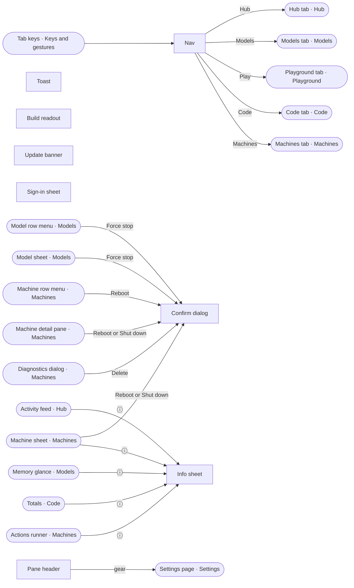
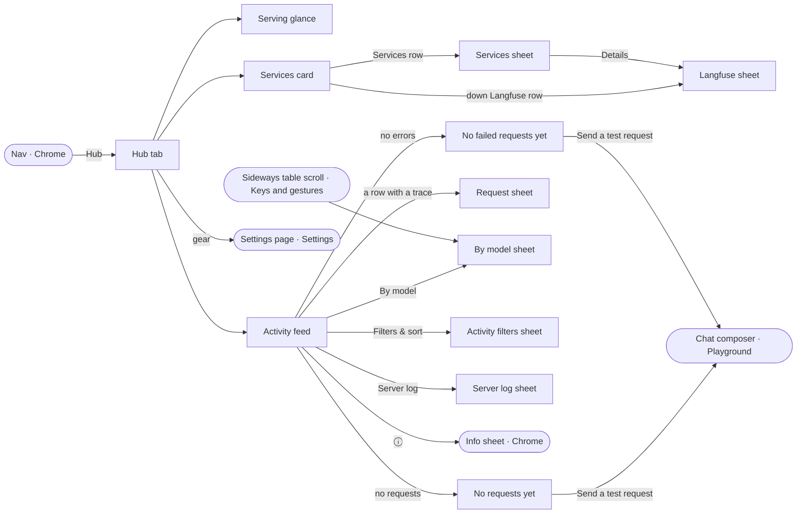
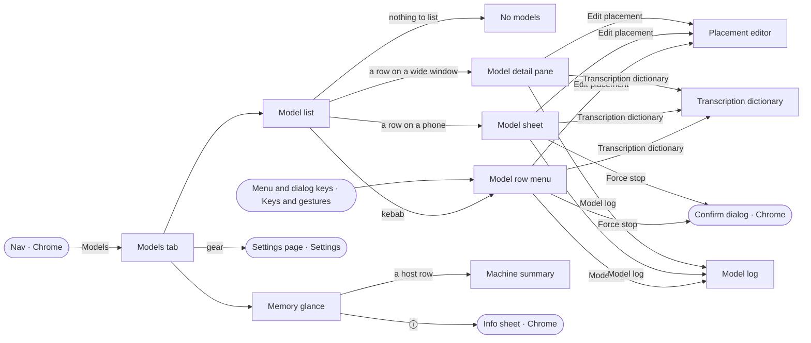
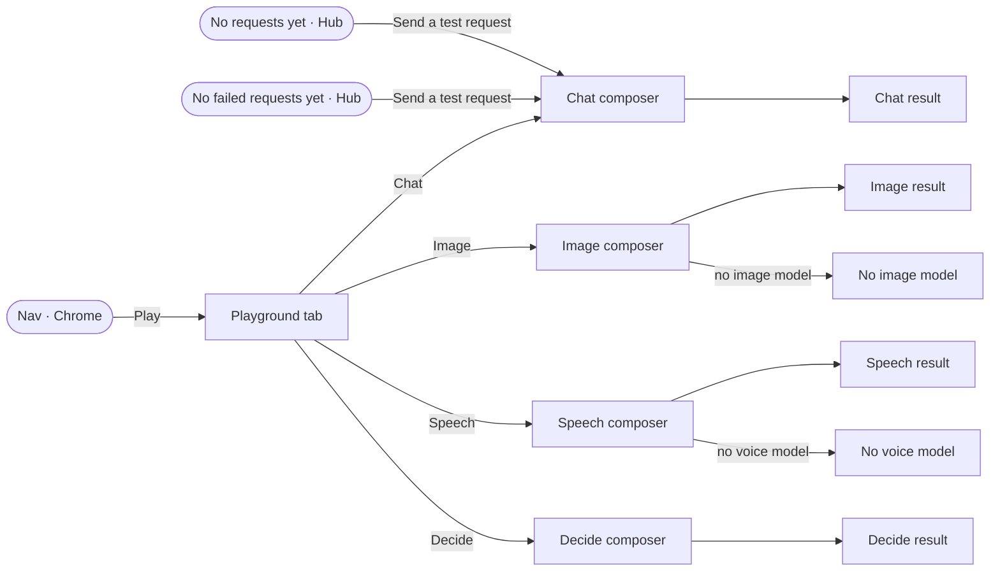
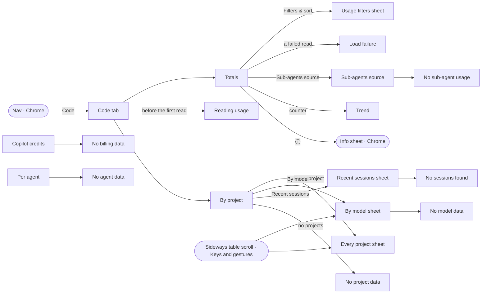
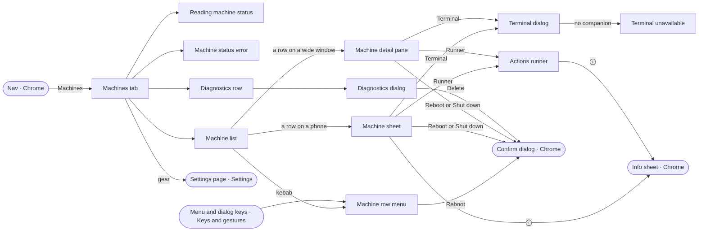
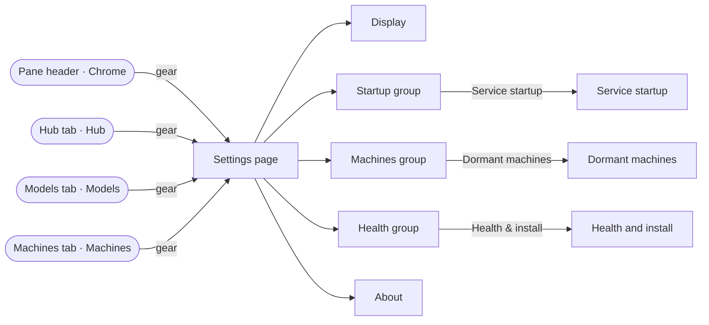
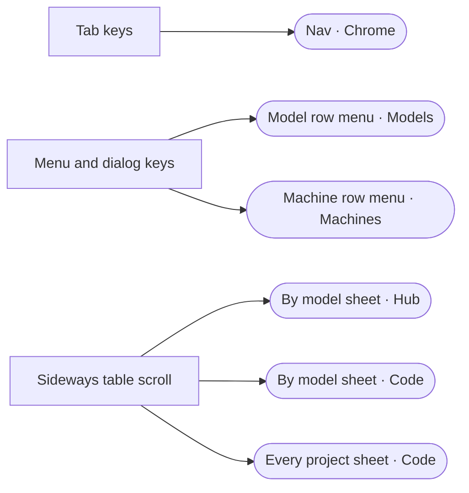

<!-- Generated from docs/ux-surfaces.yaml by scripts/ux_surface_map.py. Do not edit: change the map and re-run. -->

# UX surface map: local-llm-hub admin

Every surface a person can reach in this app, each under a stable id that its root element carries as `data-surface`. Each area has a diagram of how its surfaces connect; a rounded node is a surface in another area.

The checklist of everything a person can see and do in the hub's admin app, served at `/admin/`: every tab, sheet, dialog, menu, Settings row, empty and error state and key, with how it is reached, what is on it and what each control does. It is the exhaustive index, so a layout change can check every surface and not only the ones a reviewer happens to open.

**Ids.** `<area>.<surface>`, lowercase words joined by `.` or `-`, the same form the e2e `surface(page, "<id>")` hook takes. An id never changes when a title is reworded, and one id names one surface. The surface's root element carries the same id as `data-surface`; the vendored row menu builds its own element, so its call sites stamp the id on what `attach` returns. `scripts/ux_surface_ratchet.py` holds the markup and this map together, so the entries marked `none` and every state with no root of its own are held by this map and the e2e walk alone.

## Ground rules

**Five tabs, one gear.** The nav is Hub · Models · Play · Code · Machines. Settings is the gear in each pane's header, one tap from every tab, and is not a tab. The last tab is remembered on this device, and a stored or linked `#telemetry` (the retired OTel pane) opens Hub with the Activity feed in view.

**Layout bands** (the same markup, three placements):

| Band | Condition | Nav | Models and Machines detail | Hub, Playground, Code |
| --- | --- | --- | --- | --- |
| Phone | a touch pointer, up to 520px | floating bottom pill, hidden under an open dialog | a full-screen sheet over the list | one column |
| Narrow or mid window | a mouse below 1100px, or a touch device wider than a phone | a tab bar pinned at the top | a full-screen sheet over the list | one column |
| Wide | 1100px and up with a mouse | left rail | a detail pane beside the list (list : detail) | two columns |

**Async states.** Every list tab draws the five states of the design system: loading, ready, empty, stale (the last good data stays up, labelled with its age or "live data unavailable") and error with a Retry. A probe that did not answer reads "not confirmed", never an empty meter or a zero.

**Gating.** A surface tagged for a feature disappears or turns into a plain fact when the feature is off: Docker and Langfuse start only where Docker Desktop is installed, AgentsView only when enabled, Edit placement only on the machine that may write `config/models.yaml`, the Dictionary only on speech-to-text rows, Reboot and Shut down only where the machine supports them, Terminal only where the terminal companion answers, the runner section only on a machine that hosts one, Dormant machines only for peers. A hub with a password set refuses a call that carries no token, and the sign-in sheet opens over whatever the first refused call was; one with none set never shows it.

**Where state lives.** Per-device choices live in `localStorage`: theme, text size, the last tab, the Models Running or All scope, the Playground mode. Everything else is read live from the hub.

**Reading the diagrams.** Every row on Models and Machines opens one sheet (a pane on a wide window) whose body is shared, and every ⓘ opens the one info sheet.

## Keyboard map

| Key | Does |
| --- | --- |
| Arrow keys, Home, End | move between the tabs and open the one focused |
| Tab / Shift+Tab | move between controls |
| Enter | opens the focused row, presses the focused button, adds the typed boost term |
| Esc | closes the open menu, then the topmost sheet or dialog |
| Arrow Down / Up on a kebab | opens its menu on the first or last item |
| Arrow keys, Home, End in a menu | move between its items |

Walked 2026-11-17 against build `f5e2794`, at widths 390, 1280, themes light, dark.

## Areas

| Area | Surfaces |
|---|---|
| [Chrome](#chrome) | 8 |
| [Hub](#hub) | 12 |
| [Models](#models) | 11 |
| [Playground](#playground) | 11 |
| [Code](#code) | 19 |
| [Machines](#machines) | 12 |
| [Settings](#settings) | 9 |
| [Keys and gestures](#keys-and-gestures) | 3 |

## Chrome

What every tab shares. Each pane's header is the same card (the title, one live status line and the theme and Settings buttons), so it is listed once.

### `chrome.nav` Nav

- **Root:** `data-surface`
- **Reach:** always on screen except under an open dialog
- **Holds:** Hub, Models, Play, Code and Machines, one tab each, the active one marked
- **Does:**
  - switches the pane and resets its scroll
  - remembers the tab on this device
- **Phone:** a floating bottom pill that hides while a dialog is open
- **Desktop:** a bar at the top below 1100px with a mouse, and a left rail from 1100px
- **Why:** the fleet navigation contract; Settings is not a tab, it is the header gear
- **Leads to:**
  - [Hub tab](#hubtab-hub-tab) (Hub)
  - [Models tab](#modelstab-models-tab) (Models)
  - [Playground tab](#playgroundtab-playground-tab) (Play)
  - [Code tab](#code-usagetab-code-tab) (Code)
  - [Machines tab](#machinestab-machines-tab) (Machines)

### `chrome.header` Pane header

- **Root:** none — the same card heads every pane, so it carries no id of its own
- **Reach:** the top of each tab
- **Holds:**
  - the pane title
  - one live status line that names the exceptions (at most two, each in its tone), else one plain fact
  - the theme toggle
  - the Settings gear
- **Does:**
  - the status line never wraps, so it never moves the layout
  - the theme toggle flips light and dark and is remembered
  - the gear opens Settings
- **States:** Reading… before the first read lands
- **Leads to:** [Settings page](#settingsdialog-settings-page) (gear)

### `chrome.toast` Toast

- **Root:** `data-surface`
- **Reach:** the result of a command the person started (Start, Stop, Save, Ping, Fix)
- **Holds:** one neutral line, tinted only for an error
- **Does:** hides itself after a few seconds, and a newer toast replaces it
- **States:** a load that stays up while it runs never auto-hides

### `chrome.build-readout` Build readout

- **Root:** `data-surface`
- **Reach:** the foot of every tab
- **Holds:** the running build's short sha and its build time

### `app.update-banner` Update banner

- **Root:** `data-surface`
- **Reach:** appears on its own when a deploy lands under an open page
- **Holds:**
  - New version available
  - Reload
  - a dismiss button
- **Does:** Reload reloads the page; a dismissed banner stays down until the server moves to yet another build
- **Why:** the vendored build-watch component stamps its own id, since the app has no call site for it

### `shared.login` Sign-in sheet

- **Root:** `data-surface`
- **Reach:** opens by itself when the hub refuses a call for want of a token, on any tab
- **Holds:**
  - This hub is locked. Enter the password to continue.
  - a password field and the Sign in button, disabled until something is typed
- **Does:** a good password stores a token, closes the sheet, toasts Signed in and re-reads every tab's data
- **States:**
  - an inline error for a wrong password, too many attempts (with the seconds to wait), a server with no password set up, or an unreachable hub
  - there is no close button and Esc does nothing, since the app cannot be used signed out
- **Why:** the vendored sign-in component builds the sheet and stamps its own id

### `chrome.confirm-dialog` Confirm dialog

- **Root:** `data-surface`
- **Reach:**
  - Force stop on a model
  - Reboot or Shut down on a machine
  - Delete on a diagnostics run
- **Holds:**
  - a title and one sentence naming the target
  - the confirming button, in danger
  - a close button
- **Does:** the button runs the action and closes; the close button or Esc cancels

### `chrome.info-sheet` Info sheet

- **Root:** `data-surface`
- **Reach:** the ⓘ beside Activity, Memory, Usage, a machine's own hub, Health, Resources and the Actions runner
- **Holds:** a title and a few short paragraphs of explanation
- **Does:** the explanation that would otherwise be a permanent footnote opens here and closes with the ×

## Hub

Is the hub serving, and is anything failing.

### `hub.tab` Hub tab

- **Root:** `data-surface`
- **Reach:**
  - the Hub tab, the first one and the default
  - a stored or linked `#telemetry`
- **Holds:**
  - the pane header, whose line names an unreachable hub, a down service, the error count or a failing install check, else the uptime
  - the Serving glance and the Services card
  - the Activity feed
- **Phone:** one column
- **Desktop:** two columns, the glance and services on the left and Activity on the right
- **Leads to:**
  - [Serving glance](#hubglance-serving-glance)
  - [Services card](#hubservices-services-card)
  - [Activity feed](#hubactivity-activity-feed)
  - [Settings page](#settingsdialog-settings-page) (gear)

### `hub.glance` Serving glance

- **Root:** `data-surface`
- **Reach:** the top of the Hub tab
- **Holds:**
  - requests, errors and median latency since hub start, with the window named
  - one load sparkline (CPU, GPU, RAM or VRAM) drawn at first paint with dashes
  - a segmented control that swaps the series and carries all four current figures
  - the hub's uptime
- **Does:** the control swaps the sparkline's series; GPU and VRAM appear only where a GPU reports
- **States:** a failed read says since start · not confirmed and shows dashes, never zeros

### `hub.services` Services card

- **Root:** `data-surface`
- **Reach:** the Hub tab, under the glance
- **Holds:**
  - a row per Docker, Langfuse or AgentsView that is down, each with a Start button where it can be started
  - one summary row, Services, saying All up or N of 3 up
- **Does:**
  - the summary row and a down row open the Services sheet
  - a down Langfuse row opens the Langfuse sheet
  - Start brings that service up, with a toast for the outcome
- **States:**
  - a probe that did not answer says not confirmed and offers no Start
  - Checking… before the first answer
- **Why:** healthy services fold into one row, so only an exception takes space
- **Leads to:**
  - [Services sheet](#hubservices-sheet-services-sheet) (Services row)
  - [Langfuse sheet](#hublangfuse-sheet-langfuse-sheet) (down Langfuse row)

### `hub.activity` Activity feed

- **Root:** `data-surface`
- **Reach:** the Hub tab
- **Holds:**
  - a filter that counts what it filters and a Filters & sort button that shows how many filters are on
  - one row per request with the model, status, latency, backend and clock; a failure's status is its chip
  - By model and Server log rows at the foot
  - an ⓘ
- **Does:**
  - Filters & sort opens the sheet that holds the Requests and Errors switch
  - a row with a trace opens its sheet; a row without one does nothing on tap
  - By model opens the counters sheet and Server log the live tail
- **States:** empty, in each scope, with a way to send a test request
- **Leads to:**
  - [Activity filters sheet](#hubfilters-sheet-activity-filters-sheet) (Filters & sort)
  - [Request sheet](#hubtrace-sheet-request-sheet) (a row with a trace)
  - [By model sheet](#hubby-model-sheet-by-model-sheet) (By model)
  - [Server log sheet](#hublog-sheet-server-log-sheet) (Server log)
  - [No requests yet](#hubrequests-empty-no-requests-yet) (no requests)
  - [No failed requests yet](#huberrors-empty-no-failed-requests-yet) (no errors)
  - [Info sheet](#chromeinfo-sheet-info-sheet) (ⓘ)

### `hub.requests-empty` No requests yet

- **Root:** `data-surface`
- **Reach:** the Requests scope while the feed holds nothing
- **Holds:**
  - a line saying the ring fills as clients call the hub
  - Send a test request
- **Does:** Send a test request opens the Playground on Chat
- **Leads to:** [Chat composer](#playgroundchat-chat-composer) (Send a test request)

### `hub.errors-empty` No failed requests yet

- **Root:** `data-surface`
- **Reach:** the Errors scope while no request has failed
- **Holds:**
  - a line saying a failure shows here at once
  - Send a test request
- **Does:** Send a test request opens the Playground on Chat
- **Leads to:** [Chat composer](#playgroundchat-chat-composer) (Send a test request)

### `hub.services-sheet` Services sheet

- **Root:** `data-surface`
- **Reach:**
  - the Services summary row or a down service's row
  - Langfuse's Details button
- **Holds:**
  - a row each for Docker, Langfuse and AgentsView with its state in words and a detail line
  - Start or Stop per service, where the platform allows
  - a Langfuse and telemetry row with its health and a Details button
  - a hint, and a Launch Docker + Langfuse button while either is down and launchable
- **Does:**
  - a long detail becomes a one-line disclosure that opens in place
  - Launch brings Docker and then Langfuse up, up to about 90 seconds, with a toast for the outcome
- **States:**
  - a probe that failed says Status check failed and hides Start and Stop
  - without Docker Desktop the hint names the manual command for the platform
- **Leads to:** [Langfuse sheet](#hublangfuse-sheet-langfuse-sheet) (Details)

### `hub.langfuse-sheet` Langfuse sheet

- **Root:** `data-surface`
- **Reach:**
  - a down Langfuse row on the Services card
  - Details on the Services sheet
- **Holds:**
  - health, telemetry export, whether personal data is hidden and the endpoint
  - what telemetry export and hiding mean
  - the offline hint with the commands to bring the stack up
  - Open Langfuse UI
- **Does:** Open Langfuse UI opens the stack in its own tab
- **States:** the offline hint shows only while the stack is down and export is on

### `hub.trace-sheet` Request sheet

- **Root:** `data-surface`
- **Reach:** an Activity row that carries a trace
- **Holds:**
  - status, latency, tokens, backend and time, and the error detail of a failure
  - the prompt and completion preview
  - thumbs up and down
  - Open in Langfuse
- **Does:**
  - a thumb scores the trace and toasts the result
  - Open in Langfuse opens the trace in its own tab
- **States:**
  - Loading… while the preview is read
  - with Langfuse offline the preview says so instead of showing bodies

### `hub.by-model-sheet` By model sheet

- **Root:** `data-surface`
- **Reach:** By model at the foot of Activity
- **Holds:**
  - the summary line with requests, error rate and the window
  - a table of model, requests, errors, median, slowest 5% and tokens in and out
  - a hint that the window resets on restart
- **Does:** the table scrolls sideways when it is wider than the sheet
- **States:** a failed read says Not confirmed, never zeros
- **Phone:** a full-screen sheet
- **Desktop:** a wide dialog

### `hub.filters-sheet` Activity filters sheet

- **Root:** `data-surface`
- **Reach:** Filters & sort beside the Activity filter
- **Holds:**
  - the Requests and Errors switch
  - Clear beside Done
- **Does:**
  - the switch applies as it changes
  - Clear goes back to Requests
- **States:** the button's badge shows 1 while Errors is chosen and nothing otherwise

### `hub.log-sheet` Server log sheet

- **Root:** `data-surface`
- **Reach:** Server log at the foot of Activity
- **Holds:**
  - the hub's own log, live, newest last
  - Pause or Resume
- **Does:** Pause freezes the tail and Resume carries on

## Models

What is loaded and how much room is left.

### `models.tab` Models tab

- **Root:** `data-surface`
- **Reach:** the Models tab
- **Holds:**
  - the pane header, whose line names a model on failover, a host over capacity or not confirmed, else the number running
  - the Memory glance
  - a Running or All switch
  - the model rows, grouped by host
- **Does:**
  - the switch is remembered on this device
  - opening the tab reads the fleet's memory once; it is read again after a Start or Stop and is never polled
- **Phone:** one column, a tapped row opens a sheet
- **Desktop:** the list on the left and a detail pane on the right, the first model selected
- **Leads to:**
  - [Memory glance](#modelsmemory-glance-memory-glance)
  - [Model list](#modelslist-model-list)
  - [Settings page](#settingsdialog-settings-page) (gear)

### `models.memory-glance` Memory glance

- **Root:** `data-surface`
- **Reach:** the top of the Models tab
- **Holds:**
  - one memory meter per fleet host, drawn at once and filled when the probe answers
  - live GPU memory where the machine reports it, else the estimated footprint against the declared ceiling marked with ~, and RAM on a machine with no GPU
  - an ⓘ
- **Does:** a row opens that machine's summary
- **States:**
  - a host the probe has not answered reads not confirmed
  - stale keeps the last figures with a Last updated line
  - an unreadable summary says Memory not confirmed
- **Leads to:**
  - [Machine summary](#modelshost-summary-machine-summary) (a host row)
  - [Info sheet](#chromeinfo-sheet-info-sheet) (ⓘ)

### `models.list` Model list

- **Root:** `data-surface`
- **Reach:** the Models tab, under the switch
- **Holds:**
  - a group heading per host, this machine first
  - a row per model with an alive badge, a name, its kind, remote host, port and footprint, at most one exception chip, and one verb
  - a kebab on each row
- **Does:**
  - the row opens the model's sheet or pane
  - the verb is Start while the model is down and Stop once the hub owns it; a model another process started is Start, disabled, with Force stop in the menu
  - the 5 second poll repaints only what changed, so an open menu and focus survive it
- **States:**
  - the empty list says no model is enabled for this host or that none is running, and points at All
  - a failed read after a good one is not confirmed in the header line
- **Leads to:**
  - [Model row menu](#modelsrow-menu-model-row-menu) (kebab)
  - [Model sheet](#modelsmodel-sheet-model-sheet) (a row on a phone)
  - [Model detail pane](#modelsdetail-pane-model-detail-pane) (a row on a wide window)
  - [No models](#modelsempty-no-models) (nothing to list)

### `models.empty` No models

- **Root:** `data-surface`
- **Reach:** the Models list with nothing to show
- **Holds:**
  - No models enabled for this host, with a pointer at `config/models.yaml`
  - or No models running right now, with a pointer at All

### `models.row-menu` Model row menu

- **Root:** `data-surface`
- **Reach:**
  - the kebab on a model row
  - Arrow Down or Up on the kebab
- **Holds:**
  - a header with the host chain, the startup policy and the roles served
  - Ping, except on the billed decision backend
  - Transcription dictionary, on speech-to-text rows
  - Edit placement, on the machine that may write the registry
  - Model log, on a managed process
  - Force stop, last and in danger, on an adopted process
- **Does:**
  - Ping toasts the status and latency; a backend that does not answer is disabled
  - the others open the matching part of the model's sheet
- **Why:** destructive actions never sit on a row; Force stop is last and behind a confirm
- **Leads to:**
  - [Transcription dictionary](#modelsdictionary-editor-transcription-dictionary) (Transcription dictionary)
  - [Placement editor](#modelsplacement-editor-placement-editor) (Edit placement)
  - [Model log](#modelsmodel-log-model-log) (Model log)
  - [Confirm dialog](#chromeconfirm-dialog-confirm-dialog) (Force stop)

### `models.model-sheet` Model sheet

- **Root:** `data-surface`
- **Reach:** a model row, or a host row of the Memory glance, on a phone
- **Holds:**
  - the model's exception chips and its facts, such as kind, host, port, status, device, aliases, footprint and roles
  - its placement, the host chain with the owner marked and the startup policy
  - its actions, as the row menu offers them
  - one editor slot and the log tail
  - Force stop, last, for an adopted process
- **Does:**
  - the 5 second poll repaints only the facts, so an open editor keeps its draft
  - closing the sheet discards an open editor's draft
- **Phone:** a full-screen sheet
- **Why:** the sheet and the wide detail pane render one body
- **Leads to:**
  - [Placement editor](#modelsplacement-editor-placement-editor) (Edit placement)
  - [Transcription dictionary](#modelsdictionary-editor-transcription-dictionary) (Transcription dictionary)
  - [Model log](#modelsmodel-log-model-log) (Model log)
  - [Confirm dialog](#chromeconfirm-dialog-confirm-dialog) (Force stop)

### `models.detail-pane` Model detail pane

- **Root:** `data-surface`
- **Reach:** a model or host row on a wide window
- **Holds:**
  - the model's name with a worded Start or Stop button
  - the same body as the model sheet
- **States:** Select a model. until one is chosen
- **Desktop:** beside the list; on a phone the sheet is used instead
- **Leads to:**
  - [Placement editor](#modelsplacement-editor-placement-editor) (Edit placement)
  - [Transcription dictionary](#modelsdictionary-editor-transcription-dictionary) (Transcription dictionary)
  - [Model log](#modelsmodel-log-model-log) (Model log)

### `models.host-summary` Machine summary

- **Root:** `data-surface`
- **Reach:** a host row of the Memory glance
- **Holds:**
  - This machine, on the local host
  - an over-capacity warning where the estimate passes the declared ceiling
  - Running, the models serving there now, Loadable, those it could load, and Capacity
  - a note for a machine that is off or dormant, whose desired models apply when it powers up
- **States:**
  - Reading the fleet summary… while loading
  - Could not read the fleet summary, with Retry
  - No models placeable on this machine, naming Edit placement
- **Phone:** shown in the model sheet
- **Desktop:** shown in the detail pane

### `models.placement-editor` Placement editor

- **Root:** `data-surface`
- **Reach:**
  - Edit placement, in the row menu or the pencil in the sheet's Placement row
  - only on the machine that may write `config/models.yaml`
- **Holds:**
  - the host chain in priority order, each with a cpu tier tick, Move up, Move down and Remove
  - a picker and Add host for a host not yet in the chain
  - Startup, always on or on demand, and the idle unload minutes
  - Save and commit and Cancel
- **Does:**
  - Save validates the schema and the VRAM budget, commits `config/models.yaml` and pushes it; satellites sync on their own
  - a rejection stays inline with its arithmetic, since that detail is the point
  - the same menu item or Cancel closes it
- **States:**
  - the idle field applies only to on demand
  - an inline error in an alert
- **Why:** one editor slot that the poll never repaints, so a draft survives

### `models.dictionary-editor` Transcription dictionary

- **Root:** `data-surface`
- **Reach:** Transcription dictionary, in the row menu of a speech-to-text row
- **Holds:**
  - a note that the one list serves every whisper model
  - Replacements, ordered heard-as to correct-to rules, with add, edit and delete
  - Boost terms as chips, with a field and a launch-prompt token budget
  - Suggest from transcripts, and Save
- **Does:**
  - Suggest mines recent transcripts and offers chips to tap and then Save
  - boost terms bind on the next whisper start
- **States:**
  - Loading… and a failed load message
  - No boost terms yet
  - No new suggestions

### `models.model-log` Model log

- **Root:** `data-surface`
- **Reach:** Model log, in the row menu or the sheet's actions
- **Holds:**
  - a Log row with Refresh
  - the last 200 lines of that backend's log
- **Does:** Refresh reads it again
- **States:**
  - Reading…
  - No log yet when the backend has not started
  - Could not read the log

## Playground

One composer with four modes. Each mode owns its composer and its result, so a switch never cancels a request or shows another mode's result.

### `playground.tab` Playground tab

- **Root:** `data-surface`
- **Reach:**
  - the Play tab
  - Send a test request on an empty Activity feed
- **Holds:**
  - the pane header, whose line names a mode whose backend is missing or stopped, else the mode in use
  - a Chat, Image, Speech and Decide switch
  - the chosen mode's composer and result
- **Does:**
  - the last mode is remembered on this device
  - a mode with no usable model shows its none state
- **Desktop:** composer on the left, result on the right
- **Leads to:**
  - [Chat composer](#playgroundchat-chat-composer) (Chat)
  - [Image composer](#playgroundimage-image-composer) (Image)
  - [Speech composer](#playgroundspeech-speech-composer) (Speech)
  - [Decide composer](#playgrounddecide-decide-composer) (Decide)

### `playground.chat` Chat composer

- **Root:** `data-surface`
- **Reach:** the Chat mode, the default
- **Holds:**
  - a model picker, a prompt and a Send button
  - More options with a system prompt, an attachment (claude and gemini only) and max tokens as a preset segment with a numeric override
  - Clear
- **Does:**
  - Send posts the prompt to the chosen backend through the hub
  - an empty prompt or no model is a toast
- **Leads to:** [Chat result](#playgroundchat-result-chat-result)

### `playground.chat-result` Chat result

- **Root:** `data-surface`
- **Reach:** beside or under the Chat composer
- **Holds:**
  - Press Send and the reply shows here, until there is a reply
  - the latency, the reply and a usage grid
- **States:**
  - sending… while it runs
  - a failure shows its status and message in the reply and as a toast

### `playground.image` Image composer

- **Root:** `data-surface`
- **Reach:** the Image mode
- **Holds:**
  - an image model picker, a prompt and a size picker, each with a note
  - More options with Refine after upscaling where the model supports it and an optional reference image
  - Generate and Clear
- **Does:** a reference image edits the upload instead of generating, which is slow and experimental
- **States:** the none state when no image model is configured
- **Leads to:**
  - [Image result](#playgroundimage-result-image-result)
  - [No image model](#playgroundimage-none-no-image-model) (no image model)

### `playground.image-none` No image model

- **Root:** `data-surface`
- **Reach:** the Image composer when the hub has no image model
- **Holds:** No image model is configured on this hub

### `playground.image-result` Image result

- **Root:** `data-surface`
- **Reach:** beside or under the Image composer
- **Holds:**
  - Press Generate and the image shows here, until there is one
  - the elapsed time, the image and a Download button
- **States:** a failure clears the preview and toasts the message

### `playground.speech` Speech composer

- **Root:** `data-surface`
- **Reach:** the Speech mode
- **Holds:**
  - a voice model with its availability, a text, a language and a voice
  - a Stream switch, where the voice supports it
  - More options with a format, and speed, exaggeration and CFG weight where the voice supports them
  - Speak
- **Does:** Stream plays as it synthesizes; off gives a buffered clip with a player
- **States:**
  - the none state when no voice model is configured
  - Voice model status could not be loaded
- **Leads to:**
  - [Speech result](#playgroundspeech-result-speech-result)
  - [No voice model](#playgroundspeech-none-no-voice-model) (no voice model)

### `playground.speech-none` No voice model

- **Root:** `data-surface`
- **Reach:** the Speech composer when the hub has no voice model
- **Holds:** No voice model is configured on this hub

### `playground.speech-result` Speech result

- **Root:** `data-surface`
- **Reach:** beside or under the Speech composer
- **Holds:**
  - Press Speak and the audio plays here, until there is a clip
  - the timing and an audio player
- **States:** synthesizing…, then first audio and playing… while streaming

### `playground.decide` Decide composer

- **Root:** `data-surface`
- **Reach:** the Decide mode
- **Holds:**
  - a notice that the content goes to a third-party API hosted in the US
  - a model picker, the state being judged and the questions as JSON
  - Evaluate and Reset sample
- **Does:**
  - Evaluate posts through the hub's own decision route, so it lands in the Activity feed
  - a malformed JSON shows its error inline
- **States:** a note when the API key is not set, since evaluations would answer 503
- **Leads to:** [Decide result](#playgrounddecide-result-decide-result)

### `playground.decide-result` Decide result

- **Root:** `data-surface`
- **Reach:** beside or under the Decide composer
- **Holds:**
  - Press Evaluate and the answers show here, until there are answers
  - each answer as probability bars with the model that served it, and a usage grid

## Code

Coding-agent usage. A period and an agent choose what every card shows.

### `code-usage.tab` Code tab

- **Root:** `data-surface`
- **Reach:** the Code tab
- **Holds:**
  - the pane header, whose line names a failed load or an offline AgentsView, else the period and its total cost
  - the totals card, the trend and the breakdowns
- **Does:** polls the summary every 30 seconds while the tab is visible
- **Desktop:** totals and trend on the left, the breakdowns on the right
- **Leads to:**
  - [Totals](#code-usagetotals-totals)
  - [Reading usage](#code-usageloading-reading-usage) (before the first read)
  - [By project](#code-usageprojects-by-project)

### `code-usage.loading` Reading usage

- **Root:** `data-surface`
- **Reach:** the breakdowns column until the first summary lands, and the whole tab while it loads
- **Holds:** Reading usage…
- **Why:** a header-only table would claim an emptiness nothing has measured

### `code-usage.totals` Totals

- **Root:** `data-surface`
- **Reach:** the top of the Code tab
- **Holds:**
  - a line saying which period and agent are shown, and a Filters & sort button that shows how many filters are on
  - the total equivalent API cost and four counters with their cost and a delta against the previous period
  - how fresh the data is, an ⓘ and a note that Claude figures undercount
- **Does:**
  - a counter picks the trend's metric
  - Filters & sort opens the sheet that holds the period and the agent
- **States:** a Sub-agents source swaps the counters for its own table
- **Leads to:**
  - [Usage filters sheet](#code-usagefilters-sheet-usage-filters-sheet) (Filters & sort)
  - [Load failure](#code-usageerror-load-failure) (a failed read)
  - [Sub-agents source](#code-usagesubagents-sub-agents-source) (Sub-agents source)
  - [Trend](#code-usagetrend-trend) (counter)
  - [Info sheet](#chromeinfo-sheet-info-sheet) (ⓘ)

### `code-usage.error` Load failure

- **Root:** `data-surface`
- **Reach:** the totals card when the server reports that the summary could not be built
- **Holds:** the reason, in a banner
- **Why:** a summary that could not be built is its own state, never a zero-usage day

### `code-usage.subagents` Sub-agents source

- **Root:** `data-surface`
- **Reach:** Sub-agents in the Filters & sort sheet
- **Holds:**
  - a summary line and a note that this is a separate source, never added into All
  - a table of date, project, model, source, tokens, cache and cost
  - a hint to swipe the table sideways
- **States:** the empty state when the period holds nothing
- **Leads to:** [No sub-agent usage](#code-usagesubagents-empty-no-sub-agent-usage)

### `code-usage.subagents-empty` No sub-agent usage

- **Root:** `data-surface`
- **Reach:** the Sub-agents source with nothing in the period
- **Holds:**
  - a line saying it needs `CLAUDE_CODE_ENABLE_TELEMETRY` on the host, or a longer period
  - one button that is Retry after a failed read, Show all after a narrowed view and Refresh otherwise

### `code-usage.copilot-billing` Copilot credits

- **Root:** `data-surface`
- **Reach:** the Code tab while the Copilot agent is chosen
- **Holds:** the authoritative spend from the GitHub billing API, the total of the last 14 days and a table by date and model
- **States:** the empty state when the billing data is not available
- **Leads to:** [No billing data](#code-usagebilling-empty-no-billing-data)

### `code-usage.billing-empty` No billing data

- **Root:** `data-surface`
- **Reach:** the Copilot credits card with no data
- **Holds:** the reason billing is unavailable and the one empty-state button

### `code-usage.trend` Trend

- **Root:** `data-surface`
- **Reach:** the Code tab once a summary has landed, except for the Sub-agents source or a failed read
- **Holds:** one stacked bar chart whose metric is the counter last tapped, a bar series per vendor
- **States:** No usage to chart yet

### `code-usage.projects` By project

- **Root:** `data-surface`
- **Reach:** the breakdowns column of the Code tab
- **Holds:**
  - the projects by requests
  - Every project, By model and Recent sessions rows
- **Does:** each row opens its sheet
- **States:** the empty state with Show all
- **Leads to:**
  - [Every project sheet](#code-usageproject-sheet-every-project-sheet) (Every project)
  - [By model sheet](#code-usagemodel-sheet-by-model-sheet) (By model)
  - [Recent sessions sheet](#code-usagesessions-sheet-recent-sessions-sheet) (Recent sessions)
  - [No project data](#code-usageprojects-empty-no-project-data) (no projects)

### `code-usage.projects-empty` No project data

- **Root:** `data-surface`
- **Reach:** By project with nothing in the period or for the agent
- **Holds:**
  - a line suggesting a longer period or another agent
  - the one empty-state button
- **Does:** Show all widens the period and the agent back to everything and removes nothing

### `code-usage.per-agent` Per agent

- **Root:** `data-surface`
- **Reach:** the breakdowns column, in All
- **Holds:** a table of agent, requests, tokens in and out, cache reads and cost
- **Phone:** not shown; each agent's figures sit in the Filters & sort sheet
- **Desktop:** shown as a card
- **Leads to:** [No agent data](#code-usageper-agent-empty-no-agent-data)

### `code-usage.per-agent-empty` No agent data

- **Root:** `data-surface`
- **Reach:** Per agent with nothing in the period
- **Holds:**
  - a line suggesting a longer period
  - the one empty-state button

### `code-usage.filters-sheet` Usage filters sheet

- **Root:** `data-surface`
- **Reach:** Filters & sort on the totals card
- **Holds:**
  - a Day, Week, Month and All switch
  - an Agents group with All, every built-in agent and the extras AgentsView reports, each with its figures for the period
  - a Separate source group with Sub-agents
  - Clear beside Done
- **Does:**
  - the period and a row each apply as they change, re-read and leave the sheet open
  - Clear goes back to Day and All agents
- **States:**
  - the button's badge counts a period other than Day and an agent other than All
  - an AgentsView extra carries its freshness and an offline chip when AgentsView is down

### `code-usage.model-sheet` By model sheet

- **Root:** `data-surface`
- **Reach:** By model on the By project card
- **Holds:**
  - a table of model, requests, tokens in and out and cache reads
  - a hint to swipe the table sideways
- **States:** the empty state with Show all
- **Leads to:** [No model data](#code-usagemodel-empty-no-model-data)

### `code-usage.model-empty` No model data

- **Root:** `data-surface`
- **Reach:** the By model sheet with nothing in the period or for the agent
- **Holds:**
  - a line suggesting a longer period or another agent
  - the one empty-state button

### `code-usage.project-sheet` Every project sheet

- **Root:** `data-surface`
- **Reach:** Every project on the By project card
- **Holds:**
  - a table of project, requests and tokens in and out
  - a hint to swipe the table sideways

### `code-usage.sessions-sheet` Recent sessions sheet

- **Root:** `data-surface`
- **Reach:** Recent sessions on the By project card
- **Holds:** a list of sessions, each with its project, model, short id, first and last time, requests and tokens
- **States:** the empty state with Show all
- **Leads to:** [No sessions found](#code-usagesessions-empty-no-sessions-found)

### `code-usage.sessions-empty` No sessions found

- **Root:** `data-surface`
- **Reach:** the Recent sessions sheet with nothing to list
- **Holds:**
  - a line saying no sessions were found under the agent's transcript folder and suggesting another agent
  - the one empty-state button

## Machines

The fleet, one row per machine.

### `machines.tab` Machines tab

- **Root:** `data-surface`
- **Reach:** the Machines tab
- **Holds:**
  - the pane header, whose line names how many are offline, the stale age or how many to fix, else the machine count and how many are dormant
  - the loading and error states, then the machine list
  - a Diagnostics row under the list
- **Does:** polls the fleet every 10 seconds while the tab is visible
- **Desktop:** the list on the left and a detail pane on the right
- **Leads to:**
  - [Reading machine status](#machinesloading-reading-machine-status)
  - [Machine status error](#machineserror-machine-status-error)
  - [Machine list](#machineslist-machine-list)
  - [Diagnostics row](#machinesdiagnostics-diagnostics-row)
  - [Settings page](#settingsdialog-settings-page) (gear)

### `machines.loading` Reading machine status

- **Root:** `data-surface`
- **Reach:** the Machines tab until the first read lands
- **Holds:** Reading machine status…

### `machines.error` Machine status error

- **Root:** `data-surface`
- **Reach:** a first read that failed
- **Holds:**
  - the reason, or Could not read machine status
  - Retry
- **Does:** Retry reads again
- **States:** after a good read, a failure keeps the list and marks it stale instead

### `machines.list` Machine list

- **Root:** `data-surface`
- **Reach:** the Machines tab once the status has landed
- **Holds:**
  - a row per machine with an alive badge, a name, This machine or its role, its state or uptime and at most one exception chip
  - one verb, Wake on a down machine that has a MAC, or Start hub on a machine whose own hub is down
  - a kebab where the machine can reboot or its health needs a word
- **Does:**
  - the row opens the machine's sheet or pane
  - a dormant machine is a neutral row sorted after the live ones, and never counts as offline
- **States:**
  - stale dims the list and labels its age, and disables Reboot and Shut down against old data
  - No machines configured
- **Leads to:**
  - [Machine row menu](#machinesrow-menu-machine-row-menu) (kebab)
  - [Machine sheet](#machinesmachine-sheet-machine-sheet) (a row on a phone)
  - [Machine detail pane](#machinesdetail-pane-machine-detail-pane) (a row on a wide window)

### `machines.row-menu` Machine row menu

- **Root:** `data-surface`
- **Reach:** the kebab on a machine row
- **Holds:**
  - a header with the health verdict and its suggested fix, for a machine that is not fine
  - Reboot, in danger
- **Does:** Reboot asks for confirmation first; it is disabled, with the reason, when the hub runs here, the machine is unreachable, an action is in flight or the data is stale
- **Why:** the one fix the hub can carry out; restarting a single process stays advice
- **Leads to:** [Confirm dialog](#chromeconfirm-dialog-confirm-dialog) (Reboot)

### `machines.machine-sheet` Machine sheet

- **Root:** `data-surface`
- **Reach:** a machine row on a phone
- **Holds:**
  - the state, role and exception chips
  - CPU, RAM, GPU and disk gauges
  - Health with its verdict, findings and suggested fix, and Resources with the drive stall summary
  - Terminal and Remote
  - Connection, a disclosure with address, MAC, network, tailnet and link quality
  - Hub, for a peer that runs its own, with Sync or Start hub
  - Runner, on a machine that hosts one
  - Reboot and Shut down, last and in danger
- **Does:**
  - Terminal opens the in-browser terminal; Remote downloads the Remote Desktop file
  - Sync updates the peer's hub to main and restarts it, and is offered only when it would help
  - Reboot and Shut down ask for confirmation, and are disabled against stale data
- **States:** a dormant machine that answers again says so and where to switch Dormant off
- **Phone:** a full-screen sheet
- **Why:** the sheet and the wide detail pane render one body
- **Leads to:**
  - [Terminal dialog](#machinesterminal-dialog-terminal-dialog) (Terminal)
  - [Actions runner](#machinesrunner-actions-runner) (Runner)
  - [Confirm dialog](#chromeconfirm-dialog-confirm-dialog) (Reboot or Shut down)
  - [Info sheet](#chromeinfo-sheet-info-sheet) (ⓘ)

### `machines.detail-pane` Machine detail pane

- **Root:** `data-surface`
- **Reach:** a machine row on a wide window
- **Holds:**
  - the machine's name and a Terminal button in its head
  - the same body as the machine sheet, with the gauges in two columns
- **States:** Select a machine. until one is chosen
- **Desktop:** beside the list; on a phone the sheet is used instead
- **Leads to:**
  - [Terminal dialog](#machinesterminal-dialog-terminal-dialog) (Terminal)
  - [Actions runner](#machinesrunner-actions-runner) (Runner)
  - [Confirm dialog](#chromeconfirm-dialog-confirm-dialog) (Reboot or Shut down)

### `machines.runner` Actions runner

- **Root:** `data-surface`
- **Reach:** the sheet or pane of a machine that hosts a GitHub Actions runner
- **Holds:**
  - a headline such as Online · idle, Stopped, Not installed or Service and GitHub disagree
  - Service, GitHub, Last run and Boot as separate rows, since they fail separately
  - notes and the owner steps still outstanding
  - Install service or Start, and Stop, and an ⓘ
- **Does:**
  - Stop is refused while a job runs and while GitHub's view cannot be read, and says why
  - each action runs over SSH, then both sources are read again and the toast says what they showed
- **States:**
  - Reading… before the first read
  - Not confirmed, with Could not read the runner, when a source cannot be read; the last good reading stays up marked not current
- **Leads to:** [Info sheet](#chromeinfo-sheet-info-sheet) (ⓘ)

### `machines.diagnostics` Diagnostics row

- **Root:** `data-surface`
- **Reach:** the Machines tab, only where the hub's own machine is listed
- **Holds:** one row, Diagnostics, with This machine and the capture state as a chip
- **Does:** opens the diagnostics dialog
- **Leads to:** [Diagnostics dialog](#machinesdiagnostics-dialog-diagnostics-dialog)

### `machines.diagnostics-dialog` Diagnostics dialog

- **Root:** `data-surface`
- **Reach:** the Diagnostics row
- **Holds:**
  - Capture, with a window and a sample interval and Start capture and One-shot snapshot, or the running capture with its progress and Stop capture
  - Runs, each with its verdict, trigger and sample count
  - the chosen run's verdict, resource envelope, load by app, heaviest processes, listening ports and drift against the baseline
  - Mark as baseline, Health report, Export JSON and Delete
  - Settings, a disclosure with the daily snapshot switch, its interval, retention and Save settings
- **Does:**
  - polls every 5 seconds while the dialog is open, and leaves an unchanged body alone so an open list, focus and scroll survive
  - Delete asks for confirmation
- **States:**
  - Reading diagnostics status… and Could not read diagnostics status, with Retry
  - No captures recorded yet
  - Live data unavailable, showing the last known state
- **Why:** a capture runs inside this hub's own process, so a peer's diagnostics are opened on that peer
- **Leads to:** [Confirm dialog](#chromeconfirm-dialog-confirm-dialog) (Delete)

### `machines.terminal-dialog` Terminal dialog

- **Root:** `data-surface`
- **Reach:** Terminal in a machine's sheet or pane
- **Holds:** an in-browser SSH terminal that streams, resizes and closes with the dialog
- **States:** the unavailable message when the terminal companion does not answer
- **Leads to:** [Terminal unavailable](#machinesterminal-unavailable-terminal-unavailable) (no companion)

### `machines.terminal-unavailable` Terminal unavailable

- **Root:** `data-surface`
- **Reach:** the Terminal dialog when the terminal status says unavailable
- **Holds:** the reason, in words
- **Why:** it degrades to a clean message, never a hang or a thrown error

## Settings

The gear on every pane opens one dialog. A row with a body opens it in place of the list on a phone, with a back row, and beside the list on a wide window.

### `settings.dialog` Settings page

- **Root:** `data-surface`
- **Reach:** the gear in any pane's header
- **Holds:**
  - Display, Startup, Machines, Health and About groups
  - a close button
- **Does:** the gear opens it as the full Settings page; a row with a body opens it as a sheet
- **Phone:** a full-screen page
- **Desktop:** a centred column at the layout measure
- **Leads to:**
  - [Display](#settingsdisplay-display)
  - [Startup group](#settingsstartup-startup-group)
  - [Machines group](#settingsmachines-machines-group)
  - [Health group](#settingshealth-health-group)
  - [About](#settingsabout-about)

### `settings.display` Display

- **Root:** `data-surface`
- **Reach:** the Display group of Settings
- **Holds:**
  - Text size, Small, Default or Large
  - Theme, System, Light or Dark
- **Does:** each choice applies at once and is remembered on this device

### `settings.startup` Startup group

- **Root:** `data-surface`
- **Reach:** the Startup group of Settings
- **Holds:** Service startup, with how many services start on launch
- **Does:** opens the Service startup sheet
- **Leads to:** [Service startup](#settingsstartup-page-service-startup) (Service startup)

### `settings.startup-page` Service startup

- **Root:** `data-surface`
- **Reach:** Service startup in Settings
- **Holds:**
  - a note that each switch saves at once to `config/startup_profile.json`
  - one switch per service that comes up when the hub launches
- **Does:** a switch saves at once; a failure toasts and the switch snaps back
- **Why:** model autostart is set per model in its placement editor, not here

### `settings.machines` Machines group

- **Root:** `data-surface`
- **Reach:** the Machines group of Settings
- **Holds:** Dormant machines, with how many are marked
- **Does:** opens the Dormant machines sheet
- **Leads to:** [Dormant machines](#settingsmachines-page-dormant-machines) (Dormant machines)

### `settings.machines-page` Dormant machines

- **Root:** `data-surface`
- **Reach:** Dormant machines in Settings
- **Holds:**
  - a note on what dormant means
  - one switch per other machine, Mark as intentionally off
- **Does:** a switch saves at once to `config/machines.local.yaml` on this machine only, and the Machines tab re-reads
- **States:**
  - No other machines are configured
  - not confirmed in the group's value when the read failed
- **Why:** a machine that is off on purpose is a neutral row and raises no alert

### `settings.health` Health group

- **Root:** `data-surface`
- **Reach:** the Health group of Settings
- **Holds:** Health & install, with how many checks pass
- **Does:** opens the Health and install sheet and runs the checks the first time
- **Leads to:** [Health and install](#settingshealth-page-health-and-install) (Health & install)

### `settings.health-page` Health and install

- **Root:** `data-surface`
- **Reach:** Health & install in Settings
- **Holds:**
  - one row per check with a glyph, a label and its detail, and a Fix button on a failing one
  - Fix all, only once a check has something to fix
  - Re-check
- **Does:**
  - the checks take seconds, so they run when the sheet first opens
  - a fix toasts the outcome and re-reads
- **States:**
  - Checking… on first open
  - not confirmed in the group's value when the read failed

### `settings.about` About

- **Root:** `data-surface`
- **Reach:** the About group of Settings
- **Holds:**
  - Build, Config version and Process
  - Open Langfuse UI
  - Frontier report
- **Does:** the two link rows open in their own tab; the Frontier report is a separate page at `/admin/frontier`, not part of this map

## Keys and gestures

### `keys.nav` Tab keys

- **Root:** none — a key path, not an element
- **Reach:** focus on the nav
- **Does:** Arrow keys step between tabs and wrap at the ends, Home and End jump to the first and last, and each opens its tab
- **Leads to:** [Nav](#chromenav-nav)

### `keys.menus` Menu and dialog keys

- **Root:** none — a key path, not an element
- **Reach:** focus on a kebab, in a menu, or anywhere under an open dialog
- **Does:**
  - Arrow Down or Up on a kebab opens its menu on the first or last item
  - arrow keys, Home and End move between items, Esc closes it and returns focus to the kebab
  - Esc closes the topmost dialog, and a draft in a sheet's editor goes with it; the sign-in sheet ignores it
- **Leads to:**
  - [Model row menu](#modelsrow-menu-model-row-menu)
  - [Machine row menu](#machinesrow-menu-machine-row-menu)

### `keys.table-scroll` Sideways table scroll

- **Root:** none — a gesture, not an element
- **Reach:** a wide table on a phone
- **Does:** swipe the table sideways for every column; a hint under each table says so
- **Leads to:**
  - [By model sheet](#hubby-model-sheet-by-model-sheet)
  - [By model sheet](#code-usagemodel-sheet-by-model-sheet)
  - [Every project sheet](#code-usageproject-sheet-every-project-sheet)

## Link index

| From | Via | To |
|---|---|---|
| [Nav](#chromenav-nav) | Hub | [Hub tab](#hubtab-hub-tab) |
| [Nav](#chromenav-nav) | Models | [Models tab](#modelstab-models-tab) |
| [Nav](#chromenav-nav) | Play | [Playground tab](#playgroundtab-playground-tab) |
| [Nav](#chromenav-nav) | Code | [Code tab](#code-usagetab-code-tab) |
| [Nav](#chromenav-nav) | Machines | [Machines tab](#machinestab-machines-tab) |
| [Pane header](#chromeheader-pane-header) | gear | [Settings page](#settingsdialog-settings-page) |
| [Hub tab](#hubtab-hub-tab) |  | [Serving glance](#hubglance-serving-glance) |
| [Hub tab](#hubtab-hub-tab) |  | [Services card](#hubservices-services-card) |
| [Hub tab](#hubtab-hub-tab) |  | [Activity feed](#hubactivity-activity-feed) |
| [Hub tab](#hubtab-hub-tab) | gear | [Settings page](#settingsdialog-settings-page) |
| [Services card](#hubservices-services-card) | Services row | [Services sheet](#hubservices-sheet-services-sheet) |
| [Services card](#hubservices-services-card) | down Langfuse row | [Langfuse sheet](#hublangfuse-sheet-langfuse-sheet) |
| [Activity feed](#hubactivity-activity-feed) | Filters & sort | [Activity filters sheet](#hubfilters-sheet-activity-filters-sheet) |
| [Activity feed](#hubactivity-activity-feed) | a row with a trace | [Request sheet](#hubtrace-sheet-request-sheet) |
| [Activity feed](#hubactivity-activity-feed) | By model | [By model sheet](#hubby-model-sheet-by-model-sheet) |
| [Activity feed](#hubactivity-activity-feed) | Server log | [Server log sheet](#hublog-sheet-server-log-sheet) |
| [Activity feed](#hubactivity-activity-feed) | no requests | [No requests yet](#hubrequests-empty-no-requests-yet) |
| [Activity feed](#hubactivity-activity-feed) | no errors | [No failed requests yet](#huberrors-empty-no-failed-requests-yet) |
| [Activity feed](#hubactivity-activity-feed) | ⓘ | [Info sheet](#chromeinfo-sheet-info-sheet) |
| [No requests yet](#hubrequests-empty-no-requests-yet) | Send a test request | [Chat composer](#playgroundchat-chat-composer) |
| [No failed requests yet](#huberrors-empty-no-failed-requests-yet) | Send a test request | [Chat composer](#playgroundchat-chat-composer) |
| [Services sheet](#hubservices-sheet-services-sheet) | Details | [Langfuse sheet](#hublangfuse-sheet-langfuse-sheet) |
| [Models tab](#modelstab-models-tab) |  | [Memory glance](#modelsmemory-glance-memory-glance) |
| [Models tab](#modelstab-models-tab) |  | [Model list](#modelslist-model-list) |
| [Models tab](#modelstab-models-tab) | gear | [Settings page](#settingsdialog-settings-page) |
| [Memory glance](#modelsmemory-glance-memory-glance) | a host row | [Machine summary](#modelshost-summary-machine-summary) |
| [Memory glance](#modelsmemory-glance-memory-glance) | ⓘ | [Info sheet](#chromeinfo-sheet-info-sheet) |
| [Model list](#modelslist-model-list) | kebab | [Model row menu](#modelsrow-menu-model-row-menu) |
| [Model list](#modelslist-model-list) | a row on a phone | [Model sheet](#modelsmodel-sheet-model-sheet) |
| [Model list](#modelslist-model-list) | a row on a wide window | [Model detail pane](#modelsdetail-pane-model-detail-pane) |
| [Model list](#modelslist-model-list) | nothing to list | [No models](#modelsempty-no-models) |
| [Model row menu](#modelsrow-menu-model-row-menu) | Transcription dictionary | [Transcription dictionary](#modelsdictionary-editor-transcription-dictionary) |
| [Model row menu](#modelsrow-menu-model-row-menu) | Edit placement | [Placement editor](#modelsplacement-editor-placement-editor) |
| [Model row menu](#modelsrow-menu-model-row-menu) | Model log | [Model log](#modelsmodel-log-model-log) |
| [Model row menu](#modelsrow-menu-model-row-menu) | Force stop | [Confirm dialog](#chromeconfirm-dialog-confirm-dialog) |
| [Model sheet](#modelsmodel-sheet-model-sheet) | Edit placement | [Placement editor](#modelsplacement-editor-placement-editor) |
| [Model sheet](#modelsmodel-sheet-model-sheet) | Transcription dictionary | [Transcription dictionary](#modelsdictionary-editor-transcription-dictionary) |
| [Model sheet](#modelsmodel-sheet-model-sheet) | Model log | [Model log](#modelsmodel-log-model-log) |
| [Model sheet](#modelsmodel-sheet-model-sheet) | Force stop | [Confirm dialog](#chromeconfirm-dialog-confirm-dialog) |
| [Model detail pane](#modelsdetail-pane-model-detail-pane) | Edit placement | [Placement editor](#modelsplacement-editor-placement-editor) |
| [Model detail pane](#modelsdetail-pane-model-detail-pane) | Transcription dictionary | [Transcription dictionary](#modelsdictionary-editor-transcription-dictionary) |
| [Model detail pane](#modelsdetail-pane-model-detail-pane) | Model log | [Model log](#modelsmodel-log-model-log) |
| [Playground tab](#playgroundtab-playground-tab) | Chat | [Chat composer](#playgroundchat-chat-composer) |
| [Playground tab](#playgroundtab-playground-tab) | Image | [Image composer](#playgroundimage-image-composer) |
| [Playground tab](#playgroundtab-playground-tab) | Speech | [Speech composer](#playgroundspeech-speech-composer) |
| [Playground tab](#playgroundtab-playground-tab) | Decide | [Decide composer](#playgrounddecide-decide-composer) |
| [Chat composer](#playgroundchat-chat-composer) |  | [Chat result](#playgroundchat-result-chat-result) |
| [Image composer](#playgroundimage-image-composer) |  | [Image result](#playgroundimage-result-image-result) |
| [Image composer](#playgroundimage-image-composer) | no image model | [No image model](#playgroundimage-none-no-image-model) |
| [Speech composer](#playgroundspeech-speech-composer) |  | [Speech result](#playgroundspeech-result-speech-result) |
| [Speech composer](#playgroundspeech-speech-composer) | no voice model | [No voice model](#playgroundspeech-none-no-voice-model) |
| [Decide composer](#playgrounddecide-decide-composer) |  | [Decide result](#playgrounddecide-result-decide-result) |
| [Code tab](#code-usagetab-code-tab) |  | [Totals](#code-usagetotals-totals) |
| [Code tab](#code-usagetab-code-tab) | before the first read | [Reading usage](#code-usageloading-reading-usage) |
| [Code tab](#code-usagetab-code-tab) |  | [By project](#code-usageprojects-by-project) |
| [Totals](#code-usagetotals-totals) | Filters & sort | [Usage filters sheet](#code-usagefilters-sheet-usage-filters-sheet) |
| [Totals](#code-usagetotals-totals) | a failed read | [Load failure](#code-usageerror-load-failure) |
| [Totals](#code-usagetotals-totals) | Sub-agents source | [Sub-agents source](#code-usagesubagents-sub-agents-source) |
| [Totals](#code-usagetotals-totals) | counter | [Trend](#code-usagetrend-trend) |
| [Totals](#code-usagetotals-totals) | ⓘ | [Info sheet](#chromeinfo-sheet-info-sheet) |
| [Sub-agents source](#code-usagesubagents-sub-agents-source) |  | [No sub-agent usage](#code-usagesubagents-empty-no-sub-agent-usage) |
| [Copilot credits](#code-usagecopilot-billing-copilot-credits) |  | [No billing data](#code-usagebilling-empty-no-billing-data) |
| [By project](#code-usageprojects-by-project) | Every project | [Every project sheet](#code-usageproject-sheet-every-project-sheet) |
| [By project](#code-usageprojects-by-project) | By model | [By model sheet](#code-usagemodel-sheet-by-model-sheet) |
| [By project](#code-usageprojects-by-project) | Recent sessions | [Recent sessions sheet](#code-usagesessions-sheet-recent-sessions-sheet) |
| [By project](#code-usageprojects-by-project) | no projects | [No project data](#code-usageprojects-empty-no-project-data) |
| [Per agent](#code-usageper-agent-per-agent) |  | [No agent data](#code-usageper-agent-empty-no-agent-data) |
| [By model sheet](#code-usagemodel-sheet-by-model-sheet) |  | [No model data](#code-usagemodel-empty-no-model-data) |
| [Recent sessions sheet](#code-usagesessions-sheet-recent-sessions-sheet) |  | [No sessions found](#code-usagesessions-empty-no-sessions-found) |
| [Machines tab](#machinestab-machines-tab) |  | [Reading machine status](#machinesloading-reading-machine-status) |
| [Machines tab](#machinestab-machines-tab) |  | [Machine status error](#machineserror-machine-status-error) |
| [Machines tab](#machinestab-machines-tab) |  | [Machine list](#machineslist-machine-list) |
| [Machines tab](#machinestab-machines-tab) |  | [Diagnostics row](#machinesdiagnostics-diagnostics-row) |
| [Machines tab](#machinestab-machines-tab) | gear | [Settings page](#settingsdialog-settings-page) |
| [Machine list](#machineslist-machine-list) | kebab | [Machine row menu](#machinesrow-menu-machine-row-menu) |
| [Machine list](#machineslist-machine-list) | a row on a phone | [Machine sheet](#machinesmachine-sheet-machine-sheet) |
| [Machine list](#machineslist-machine-list) | a row on a wide window | [Machine detail pane](#machinesdetail-pane-machine-detail-pane) |
| [Machine row menu](#machinesrow-menu-machine-row-menu) | Reboot | [Confirm dialog](#chromeconfirm-dialog-confirm-dialog) |
| [Machine sheet](#machinesmachine-sheet-machine-sheet) | Terminal | [Terminal dialog](#machinesterminal-dialog-terminal-dialog) |
| [Machine sheet](#machinesmachine-sheet-machine-sheet) | Runner | [Actions runner](#machinesrunner-actions-runner) |
| [Machine sheet](#machinesmachine-sheet-machine-sheet) | Reboot or Shut down | [Confirm dialog](#chromeconfirm-dialog-confirm-dialog) |
| [Machine sheet](#machinesmachine-sheet-machine-sheet) | ⓘ | [Info sheet](#chromeinfo-sheet-info-sheet) |
| [Machine detail pane](#machinesdetail-pane-machine-detail-pane) | Terminal | [Terminal dialog](#machinesterminal-dialog-terminal-dialog) |
| [Machine detail pane](#machinesdetail-pane-machine-detail-pane) | Runner | [Actions runner](#machinesrunner-actions-runner) |
| [Machine detail pane](#machinesdetail-pane-machine-detail-pane) | Reboot or Shut down | [Confirm dialog](#chromeconfirm-dialog-confirm-dialog) |
| [Actions runner](#machinesrunner-actions-runner) | ⓘ | [Info sheet](#chromeinfo-sheet-info-sheet) |
| [Diagnostics row](#machinesdiagnostics-diagnostics-row) |  | [Diagnostics dialog](#machinesdiagnostics-dialog-diagnostics-dialog) |
| [Diagnostics dialog](#machinesdiagnostics-dialog-diagnostics-dialog) | Delete | [Confirm dialog](#chromeconfirm-dialog-confirm-dialog) |
| [Terminal dialog](#machinesterminal-dialog-terminal-dialog) | no companion | [Terminal unavailable](#machinesterminal-unavailable-terminal-unavailable) |
| [Settings page](#settingsdialog-settings-page) |  | [Display](#settingsdisplay-display) |
| [Settings page](#settingsdialog-settings-page) |  | [Startup group](#settingsstartup-startup-group) |
| [Settings page](#settingsdialog-settings-page) |  | [Machines group](#settingsmachines-machines-group) |
| [Settings page](#settingsdialog-settings-page) |  | [Health group](#settingshealth-health-group) |
| [Settings page](#settingsdialog-settings-page) |  | [About](#settingsabout-about) |
| [Startup group](#settingsstartup-startup-group) | Service startup | [Service startup](#settingsstartup-page-service-startup) |
| [Machines group](#settingsmachines-machines-group) | Dormant machines | [Dormant machines](#settingsmachines-page-dormant-machines) |
| [Health group](#settingshealth-health-group) | Health & install | [Health and install](#settingshealth-page-health-and-install) |
| [Tab keys](#keysnav-tab-keys) |  | [Nav](#chromenav-nav) |
| [Menu and dialog keys](#keysmenus-menu-and-dialog-keys) |  | [Model row menu](#modelsrow-menu-model-row-menu) |
| [Menu and dialog keys](#keysmenus-menu-and-dialog-keys) |  | [Machine row menu](#machinesrow-menu-machine-row-menu) |
| [Sideways table scroll](#keystable-scroll-sideways-table-scroll) |  | [By model sheet](#hubby-model-sheet-by-model-sheet) |
| [Sideways table scroll](#keystable-scroll-sideways-table-scroll) |  | [By model sheet](#code-usagemodel-sheet-by-model-sheet) |
| [Sideways table scroll](#keystable-scroll-sideways-table-scroll) |  | [Every project sheet](#code-usageproject-sheet-every-project-sheet) |
